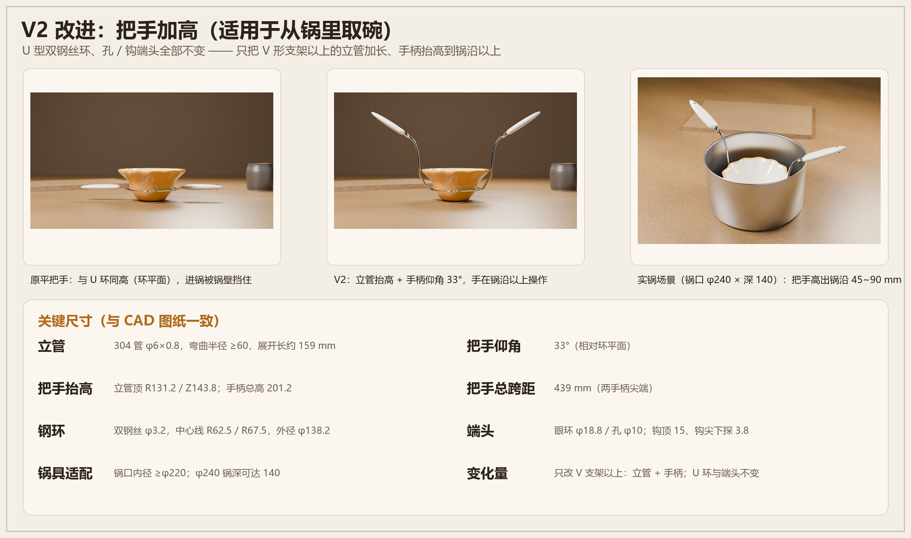
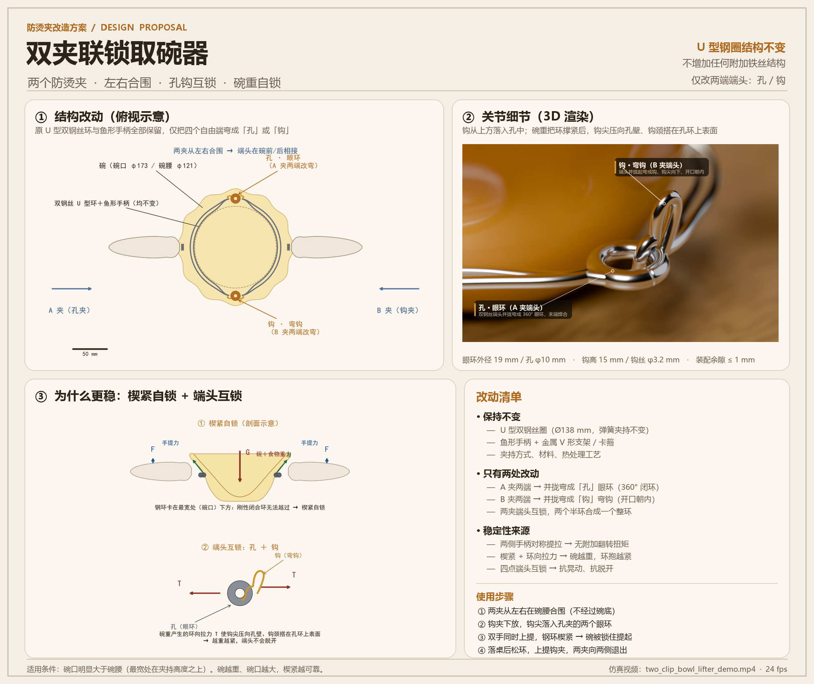

# 双夹联锁取碗器 —— 防烫夹「孔 + 钩」改造方案（V2 加高把手版）

> 目标：改造现有的双钢丝 U 型防烫夹（鱼形手柄），解决单夹提重碗时**不易提起**、**易向手柄反方向翻倒**的问题；V2 进一步解决**从锅里取碗时锅壁挡住手/把手**的问题。
> 方案：**两只夹子左右合围，一夹两端做成「孔」（眼环），另一夹两端做成「钩」（弯钩），钩从上方落入孔中，靠碗重自锁**；V2 只把 **V 形支架以上的立管加长、手柄抬高（仰角 33°，总高 201 mm）**，U 环与孔/钩端头完全不变。
> 交付：仿真视频 `video/two_clip_bowl_lifter_demo.mp4`、CAD 图纸 `design/cad/clips_drawings.pdf` + `clips.dxf`、设计图 `design/design_sheet.png`、V2 改进说明 `design/v2_improvement.png`、实物制作指南 `docs/实物制作指南.md`。





🎬 仿真视频：[`video/two_clip_bowl_lifter_demo.mp4`](video/two_clip_bowl_lifter_demo.mp4)（21.5 s / 1280×720 / 24 fps，GitHub 页面点击即可播放）

## 0. 仓库导览

| 内容 | 位置 |
|---|---|
| 仿真视频（孔/钩互锁 + 楔紧自锁全过程） | `video/two_clip_bowl_lifter_demo.mp4` |
| V2 改进说明（平把手 → 加高把手、实锅场景、关键尺寸） | `design/v2_improvement.png` |
| CAD 图纸（3 张 A3：总装 / 零件 / 端头细节 + 锅具适配） | `design/cad/clips_drawings.pdf` |
| CAD 几何（1:1 毫米，可在 CAD 中量取/修改） | `design/cad/clips.dxf` |
| 实物制作指南（材料/工具、三条路线、工艺坑、检验） | `docs/实物制作指南.md` |
| 设计说明图（俯视结构、关节细节、自锁原理） | `design/design_sheet.png` |
| 3D 渲染图（关节、提起、合围、加高把手、锅场景） | `design/*.png` |
| Blender 场景与生成脚本 | `scenes/two_clip_demo.blend`（V1）、`scenes/two_clip_v2.blend`（V2 加高把手）、`scripts/` |

---

## 1. 方案要点（原结构不动）

| 项目 | 处理 |
|---|---|
| 双钢丝 U 型环（Ø138 mm） | **不动**，夹持方式、弹性、包角全部保留 |
| 鱼形手柄、金属 V 形支架 / 卡箍 | **不动** |
| 附加铁丝 / 附加零件 | **不加** |
| 仅有的改动 | A 夹的 2 个自由端 → 弯成「孔」眼环；B 夹的 2 个自由端 → 弯成「钩」弯钩 |

原夹的四个自由端头（每只夹两端、每端两股钢丝）并拢后弯制：
- **孔夹（A）**：端头并拢 → 收成一股 → 盘成 360° 小眼环，末端焊合（眼环外径 19 mm、孔 φ10 mm）。
- **钩夹（B）**：端头并拢 → 收成一股 → 向上起弯成钩（钩高约 15 mm、钩丝 φ3.2 mm），钩尖向下、开口朝内。

## 2. 工作过程（与仿真视频一致）

1. 两只夹子从碗左右两侧靠近，**高度在碗腰**（距桌面 30 mm），U 环从两侧兜住碗身，**不经过碗底**。
2. 钩夹稍稍抬高（+9.5 mm）到位后**向下放**，两个钩尖从上方分别落入孔夹两个眼环中。
3. 双手同时上提两侧手柄：钢环沿碗身外壁向上滑移，直到卡在碗口最宽处下方 → **楔紧自锁**；此时环向拉力把两夹端头拉紧，钩孔越锁越死。
4. 提起、平移、落桌。碗放稳后把两夹向下松，钢环自行下滑到碗脚处（卸载）。
5. 上提钩夹（+12 mm）使钩尖从眼环中退出，两夹分别向两侧抽出。

## 3. 为什么稳定（物理）

- **单夹的问题**：只有一个提手、只有一侧受力。手对柄的力矩会让钢圈绕碗身偏转，重碗时易打滑、并向手柄反方向倾倒。
- **双夹合围后**：
  1. 两个手柄在碗两侧对称上提，系统对称受力，几乎没有附加翻转力矩；
  2. 两端钩孔互锁，把两个半环连成**闭合刚性环** —— 单夹时开口会被碗重撑开、打滑，闭合后钢环无法张开；
  3. **楔紧自锁**：钢环内径大于碗腰、小于碗口最宽处。上提时环沿碗的锥面向"宽处"移动被挡住，碗重越大，法向楔紧力越大，钢环不可能越过碗口 → 越重越紧；
  4. 环向拉力 T 由两端钩孔承担：**钩尖被孔壁压住 + 钩颈搭在孔环上表面**，形成两点接触，拉力越大越不会脱开，且没有任何附加扭矩。

> 仿真视频中可以看到：抬升初期钢环先空走约 15 mm 才贴住碗壁（楔紧行程），继续上提碗才离开桌面；落桌后钢环会自动向下松脱 —— 这些都是楔紧结构本身的物理表现。

## 4. 尺寸与适配条件

- 碗：碗口 Ø173 mm / 碗腰 Ø121 mm / 高 83 mm（仿真用碗，含食物按 1.2 kg 计）。
- 钢环：内缘 Ø122 mm（比碗腰大 ~1 mm/侧，能套入；比碗口小 51 mm，无法越过）。
- 适用条件：**碗的最宽处必须位于夹持高度之上**（绝大多数碗/盘满足）。若碗最宽处在碗腰以下，环会上滑套出，不适用。
- 碗腰间隙：夹环套入时单边约 2~3 mm；夹环被提起后自动楔紧，不需要弹簧预紧。

## 5. 可制造性

- 端头为 φ3.2 mm 不锈钢弹簧钢丝，眼环 / 弯钩可直接冷弯成型；眼环末端点焊或钎焊合。
- 钩尖倒圆（R≥1 mm），保证能顺畅落入孔内、不刮手。
- 建议眼环孔 φ10 mm、钩丝 φ3.2 mm；装配后钩尖与孔壁留 0.5~1 mm 预置间隙，加载后自动贴紧。
- 量产时两只夹可做成一左一右（孔夹 / 钩夹）配套销售；不改变原夹的弹簧热处理与手柄装配工艺。

## 6. 仿真视频说明

- 3D 场景：Blender 4.5（Cycles GPU 渲染），1280×720 / 24 fps / 21.5 s。
- 碗为**实体封闭网格**（带壁厚、碗口波浪边），夹子为实体钢丝管 + 塑料手柄；全程按刚体运动学逐帧计算，**无穿模**：
  - 夹环进入 / 抬升 / 下滑时，环内缘始终与碗身保持间隙或贴合，不会穿入碗壁；
  - 钩孔在装配/拆卸过程中按实际间隙通过，钩不会穿过孔环实体；
  - 提起后碗与两夹作为刚性组合体一起运动（楔紧锁死），落桌后碗单独落座，钢环下滑卸载。
- 说明：为突出机构，动画**省略了人手**（手柄按"被手持"的轨迹运动），并非"夹子会自己飞"。
- 该视频为 V1（平把手）版本；V2 只把把手加高，**关节的锁/卸动作与视频完全一致**（V2 尺寸见 6.5 节与 CAD 图纸）。
- 视频分镜与时间轴（24 fps，共 516 帧 / 21.5 s）：
  1. `0.0–5.2 s` 全景：标题 + 双夹从左右合围（高度在碗腰）；
  2. `5.2–7.2 s` 关节特写：钩夹下放，钩尖落入孔中（画面标注「孔」「钩」）；
  3. `7.2–17.5 s` 中景：端头互锁 → 楔紧 → 提起 → 平移 → 落桌 → 钢环下滑卸载；
  4. `17.5–19.4 s` 关节特写：上提钩夹，钩尖抽出眼环（卸锁）；
  5. `19.4–21.5 s` 全景：两夹退出，碗单独留在桌面；片尾说明卡。

## 6.5 V2 改进：把手加高（锅中取碗）

**问题**：V1 的鱼形手柄与 U 环在同一平面（环平面高度）。如果要取**锅里面的碗**，锅壁会把把手和手挡住，两只夹子无法从左右水平靠近碗腰。

**V2 做法**：只改 V 形支架以上部分 —— 加一根 **φ6×0.8 不锈钢立管**（按 R-Z 坐标表弯制，展开长约 159 mm），把卡箍和鱼形手柄抬高到**环平面以上 143.8 mm**，手柄仰角 **33°**，总高 **201 mm**。于是：

- 两只夹子可以从**锅口上方**放进锅里，套过碗沿、落在碗腰；
- 手柄高出锅沿，**双手在锅沿以上操作**，锅壁不再挡手；
- U 环、孔、钩、自锁原理**全部不变**（视频演示的关节动作仍然有效）。

**锅具适配**（碗坐锅底、环平面距锅底约 30 mm）：

| 锅口内径 | 建议最大锅深 | 把手高出锅沿 |
|---|---|---|
| ≥ φ220 | ≈ 120 mm | ≈ 60 mm |
| ≥ φ240 | ≈ 140 mm | ≈ 45 mm |
| ≥ φ260 | ≈ 160 mm | ≈ 30 mm |

**V2 文件**：
- `design/v2_improvement.png` —— 改前/改后对比 + 实锅场景 + 关键尺寸（一页说明）
- `design/v2_clip_pair.png` —— V2 双夹合围 3D 渲染
- `design/v2_pot_scene.png` / `v2_pot_scene_low.png` —— 锅中取碗场景 3D 渲染
- `design/compare_flat.png` / `compare_raised.png` —— 同机位改前/改后对比
- `design/v2_handle_detail.png` —— 加高把手细节渲染

## 7. 文件清单

| 文件 | 说明 |
|---|---|
| `video/two_clip_bowl_lifter_demo.mp4` | 仿真视频（含中文字幕/标注） |
| `design/design_sheet.png` | 设计说明图（俯视结构、关节细节、自锁原理、改动清单） |
| `design/joint_macro.png` | 关节锁合状态 3D 渲染 |
| `design/joint_macro_labeled.png` | 关节锁合状态（带「孔 / 钩」标注） |
| `design/joint_separated.png` | 钩/孔分离状态 3D 渲染 |
| `design/hero_lift.png` | 提起状态 3D 渲染 |
| `design/assembled_table.png` | 合围状态 3D 渲染 |
| `design/v2_improvement.png` | **V2 改进说明**（平把手 vs 加高把手 + 实锅场景 + 尺寸） |
| `design/v2_clip_pair.png` | V2 双夹合围 3D 渲染（加高把手） |
| `design/v2_pot_scene.png` | 锅中取碗场景 3D 渲染（锅口 φ240 / 深 140） |
| `design/compare_flat.png` / `compare_raised.png` | 同机位改前 / 改后对比 |
| `design/cad/clips_drawings.pdf` | **CAD 图纸（3 张 A3：总装图 / 零件图 / 端头细节 + 锅具适配）** |
| `design/cad/clips.dxf` | **CAD 几何文件（1:1 毫米，可在 CAD 中量取/修改）** |
| `design/cad/sheet1_assembly.png` 等 | CAD 图纸单页 PNG |
| `docs/实物制作指南.md` | **实物制作指南**（材料/工具、改造路线、3D 打印验证、工艺坑、检验清单、成本） |
| `scenes/two_clip_demo.blend` | Blender 场景 V1（平把手，动画/视频用） |
| `scenes/two_clip_v2.blend` | Blender 场景 V2（加高把手，锅中使用，静帧渲染用） |
| `scripts/` | 建模、动画、渲染、后期、图表、CAD 出图脚本 |

## 8. 复现（从源码重新生成）

依赖：Blender 4.5 LTS（便携版即可，脚本用其自带 Python + bpy）、Python 3.12（PIL / numpy / matplotlib / ezdxf / imageio-ffmpeg）。

```bash
# 1) 建模 + 保存场景（1280x720 / 32 samples / 曝光 -1.1）
blender -b --factory-startup --python scripts/build_scene.py -- --samples 32 --res 1280x720 --exposure -1.1

# 2) 渲染动画（可断点续渲：跳过已存在的帧）
blender -b --factory-startup --python scripts/render_anim.py -- start=1 end=516 res=1280x720 samples=32

# 3) 后期（调色 + 中文字幕 + 关节标注 + 片尾）并编码 mp4
python scripts/post.py --encode

# 4) 高分辨率设计渲染图
blender -b --factory-startup --python scripts/render_stills.py
blender -b --factory-startup --python scripts/build_v2.py --                      # V2 加高把手静帧
blender -b --factory-startup --python scripts/build_v2.py -- only=save            # 保存 V2 场景到 scenes/

# 5) 设计说明图 / 受力示意图 / CAD 图纸 / DXF
python scripts/design_sheet.py
python scripts/diagrams.py
python scripts/cad_sheets.py
```

说明：
- 仓库**未包含** `tools/`（Blender 便携版约 900 MB）、`video/frames/`（516 帧 PNG，约 450 MB）、`video/post/` 等中间产物，均可由上面脚本重新生成；
- `design/product_original.png`（原始产品照片）因版权原因未入库；
- 渲染使用 Cycles（AMD GPU 走 HIP；NVIDIA 可改 CUDA），脚本会显式启用 GPU 设备，避免静默回退 CPU。

## 9. 备注与可深入方向

- 本方案是**概念设计 + 物性仿真验证**，未做实物样件与强度校核；钩孔局部建议按 3~5 kg 静载做一次拉伸/疲劳校核。
- 眼环与钩的尺寸可按目标碗型（碗口/碗腰比）参数化调整，碗口越大，楔紧越可靠。
- 若希望单手操作，可进一步把两只夹的"手柄—端头"做成联动（如一根软带连接两柄），本方案未增加任何附加结构。
- V2 的立管可做成**可拆/可调高度**（插接 + 销孔），这样一只夹子既能当普通台面夹用（低把手），也能进锅用（高把手）；本版先做固定式，便于焊接与检验。
- 仿真视频仍为 V1（平把手）版本，用于演示**孔/钩互锁与楔紧自锁**这一不变的机构；V2 只改变把手高度，不改变关节动作。
